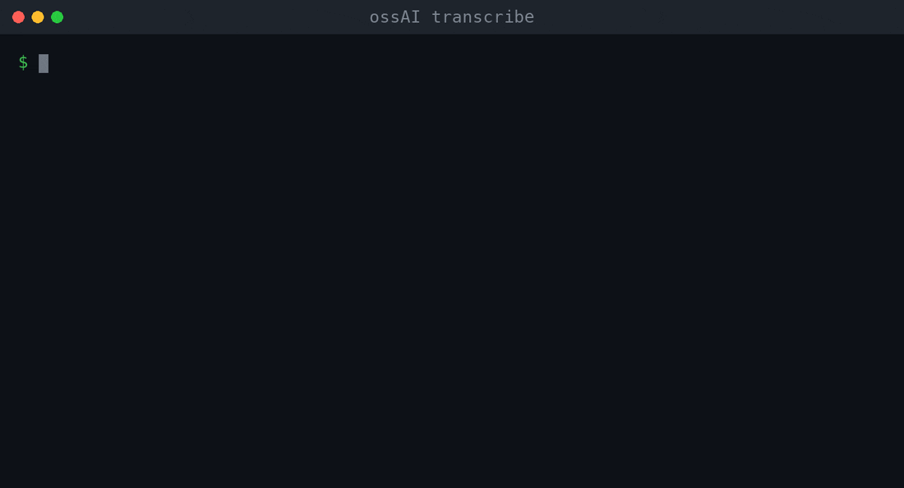

# ossAI transcribe

Offline speech-to-text for audio and video files. A small command-line tool and a PySide6 desktop window, both built on [faster-whisper](https://github.com/SYSTRAN/faster-whisper). Nothing leaves your machine after the model is downloaded once.



## Install

Python 3.10 to 3.13 is the safe range.

```bash
git clone https://github.com/Kipung/ossAI_transcribe
cd ossAI_transcribe
python3 -m venv .venv && source .venv/bin/activate
pip install -r requirements.txt
```

`av` is pinned below 16 because newer releases break faster-whisper's audio decoding. Models download from Hugging Face on first use and are cached.

## Command line

```bash
python transcribe.py samples/meeting.wav --model tiny.en --timestamps --srt
```

| Option | Meaning |
| --- | --- |
| `--model` | `tiny`, `base`, `small` (default), `medium`, `large-v3`, `distil-*`, and the `.en` variants |
| `--language` | Force a language code such as `en`, `ko`, `es`. Detected automatically by default |
| `--srt`, `--vtt` | Also write subtitles |
| `--timestamps` | Print one `[start -> end] text` line per segment |
| `--vad-filter` | Skip silence |
| `--output` | Output basename without extension. Defaults to the input file name |
| `--device` | `auto` (default), `cpu`, `cuda` |
| `--compute-type` | `float16` (default on CUDA), `int8` (used automatically on CPU), and others faster-whisper accepts |

`--device auto` picks CUDA when an NVIDIA GPU is visible and CPU otherwise. Apple Silicon runs on CPU: faster-whisper's backend, CTranslate2, has no Metal support.

## Outputs

For `meeting.wav` the tool writes `meeting.txt` (one line per segment) and, on request, `meeting.srt` and `meeting.vtt`. Subtitle timestamps use `HH:MM:SS,mmm` for SRT and `HH:MM:SS.mmm` for VTT.

## Desktop window

```bash
python gui_transcribe.py
```

Pick a file, a model and an output folder, then press the button. It uses the same subtitle writers as the CLI. If a CTranslate2 model sits in `models/whisper-tiny/`, the window uses it and stays fully offline, which is how the packaged builds work.

## Where this went next

This repo is the file-in, text-out starting point. Two projects grew from it:

- [ossAI_live_transcribe](https://github.com/Kipung/ossAI_live_transcribe) transcribes a microphone live, with a fast draft that a slower model corrects a few seconds later.
- [meeting-notes-electron](https://github.com/Kipung/meeting-notes-electron) is a desktop app that records a meeting, transcribes it and summarizes it with a local model.
